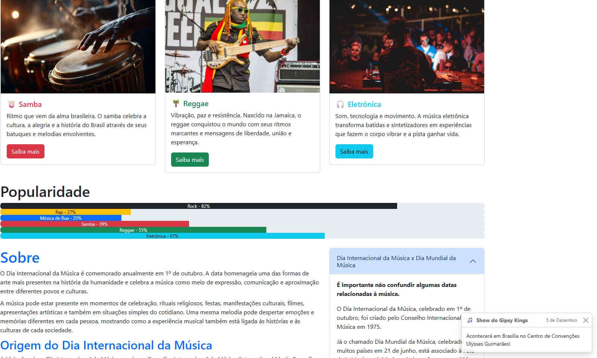

# Dia Internacional da Música

Site acadêmico sobre o Dia Internacional da Música, desenvolvido com HTML e Bootstrap.

## Tecnologias

- HTML5
- Bootstrap
- CSS
- JavaScript (componentes do Bootstrap)

## Recursos utilizados

- Navbar responsiva
- Carrossel de imagens
- Cards de gêneros musicais
- Barras de progresso
- Accordion
- Modal
- Toast
- Footer

## Como executar

1. Baixe ou clone o repositório.
2. Abra o arquivo `index.html` em um navegador.

## 📷 Demonstração

A imagem abaixo mostra parte da interface do site, incluindo cards de gêneros musicais, barras de popularidade, accordion e toast.

## Autores

- Matheus Guerra
- Arthur Hansel

## 🌐 Acesse o site

🔗 [Clique aqui para visualizar o projeto online](https://matheusguerraf122.github.io/site-dia-internacional-musica/)

## 📄 Licença

Este projeto está sob a licença **MIT**.
